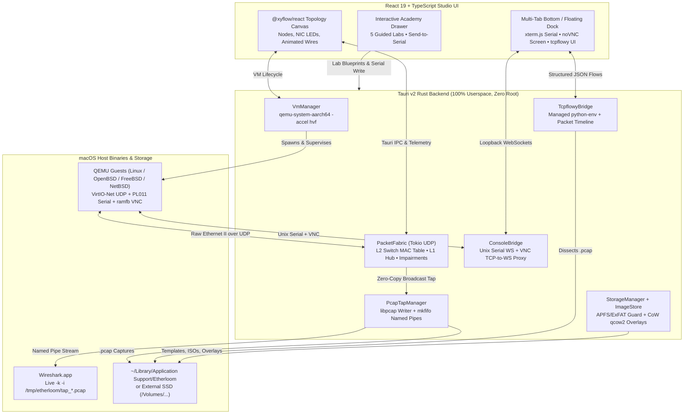

# Etherloom

**Open-source, zero-root macOS network orchestration and packet-inspection studio** built for Apple Silicon (`aarch64`) and Intel Macs.

[](https://github.com/diorgulescu/etherloom/actions/workflows/ci.yml)
[](https://github.com/diorgulescu/etherloom/actions/workflows/release-macos.yml)
[](https://www.gnu.org/licenses/gpl-3.0)
[-0f172a.svg)](#prerequisites-macos)
[](#architecture)
[](#zero-root-wiretaps--tcpflowy-visual-flow-dissector)

Etherloom lets students, systems engineers, and security practitioners design multi-OS virtual topologies (**Linux**, **OpenBSD**, **FreeBSD**, and **NetBSD** alongside built-in **L2 Ethernet Switches** and **L1 Hubs**), inject live link impairments, stream wiretaps directly into **Wireshark**, and visually dissect TCP flows inside the app using [**`tcpflowy`**](https://github.com/diorgulescu/tcpflowy) — all in **100% unprivileged userspace** with zero kernel extensions, zero `vmnet` helper daemons, and zero `sudo` prompts.

---

## Highlights

- **Zero-Root Userspace Packet Fabric**: QEMU VirtIO NICs attach via loopback UDP datagram sockets (`127.0.0.1`) to an async Rust `PacketFabric` that forwards raw Ethernet II frames, performs IEEE 802.1D MAC learning/aging on L2 Switches, floods frames on L1 Hubs, and enforces per-wire **Latency**, **Jitter**, **Packet Loss %**, and **Cable Cut** impairments in real time.
- **First-Class BSD & Linux Support**: Built-in OS profiles with accurate guest interface naming (`eth0` on Alpine/Linux, `vio0` on OpenBSD, `vtnet0` on FreeBSD, `vioif0` on NetBSD), UEFI `edk2-aarch64-code.fd` firmware boot, `.iso`/`.img` installer wizard, and 1-click Copy-on-Write (`qcow2`) **Golden Template** promotion.
- **Unified Dual-Console Workspace**: Every VM exposes both a zero-buffered **Serial Console** (`@xterm/xterm` over Unix domain sockets for `tmux`, `vi`, `pfctl`, `systat`, and BSD text installers) and an **Embedded UEFI / Framebuffer Screen** (`@novnc/novnc` over a Rust VNC-to-WebSocket proxy, plus optional native QEMU Cocoa window mode).
- **One-Click Wiretaps & Integrated `tcpflowy` Flow Dissector**:
  - **Record `.pcap`**: Write microsecond-timestamped `LINKTYPE_ETHERNET` captures directly into the active `.etherloom/captures/` bundle.
  - **Live Wireshark Stream**: Spawn macOS `Wireshark.app` attached to a `/tmp/etherloom/tap_<link>.pcap` named FIFO pipe for zero-privilege real-time packet inspection.
  - **`tcpflowy` Visual Dissector**: Managed Python virtual environment (`python-env/`) running `tcpflowy` with interactive **Packet Ladder Diagrams** (`SYN` / `SYN-ACK` / `PSH,ACK` / `FIN` + red retransmission & zero-window highlights), **Reconstructed ASCII / Hex Streams**, **SPLT Timing & Entropy Telemetry**, and **Auto-Synthesized Suricata / Wireshark / BPF Rules**.
- **Interactive Networking Academy**: 5 built-in, vendor-neutral guided labs with topology blueprints, step-by-step tasks, ASCII protocol diagrams, wire highlights, and **1-click Send to Serial** command blocks.
- **External SSD Resilience (`/Volumes/...`)**: Split storage engine keeping sockets, FIFOs, and Python symlinks local while storing heavy `.iso` media, base `.qcow2` templates, and `.etherloom` workspaces on internal APFS or external Thunderbolt/USB-C SSDs (including ExFAT support and automatic `qcow2` backing-file rebasing).

---

## Architecture



See [ARCHITECTURE.md](ARCHITECTURE.md) for the complete system specification, port-allocation schemes, `topology.toml` schema, and socket protocols.

---

## Prerequisites (macOS)

Etherloom runs on **macOS 13+** (Apple Silicon M1/M2/M3/M4 with native `Hypervisor.framework` acceleration, or Intel Macs).

### 1. Runtime Dependencies (Homebrew)

```bash
# Required: QEMU + UEFI firmware (edk2-aarch64-code.fd) + qemu-img
brew install qemu

# Optional (recommended): Live wiretap streaming in Wireshark.app
brew install --cask wireshark

# Optional (recommended): Python 3.10+ (or uv) for the in-app tcpflowy Flow Dissector
brew install python uv
```

> **Built-in Environment Doctor**: Because macOS GUI `.app` bundles launch with a minimal `PATH`, Etherloom's `env_doctor` automatically probes `/opt/homebrew/bin`, `/usr/local/bin`, `/Applications/Wireshark.app`, and `~/.local/bin` on startup and displays actionable diagnostics in the top toolbar.

### 2. Build Toolchain (From Source)

- **Rust** (`1.77+` stable via [`rustup`](https://rustup.rs/))
- **Node.js** (`20+` LTS) & `npm`
- **Xcode Command Line Tools**: `xcode-select --install`

---

## Quickstart

### 1. Clone & Run in Development Mode

```bash
git clone https://github.com/diorgulescu/etherloom.git
cd etherloom

# Install frontend packages
npm install

# Launch the Tauri v2 macOS desktop studio
npm run tauri dev
```

To build a standalone macOS `.app` / `.dmg` bundle:

```bash
npm run tauri build
```

### 2. Provision ARM64 Base Templates Automatically (`scripts/prepare_library.sh`)

Use the included [`scripts/prepare_library.sh`](scripts/prepare_library.sh) helper (also callable as `scripts/prepare-library.sh`) to download, verify, expand, and write-protect official `aarch64` base images (**Alpine Linux**, **FreeBSD UFS**, **NetBSD**, and the SHA-256-verified **OpenBSD** installer kit) onto your internal SSD or an external USB-C/Thunderbolt SSD:

```bash
# Install xz alongside qemu for decompressing FreeBSD / Alpine cloud images
brew install qemu xz

# Provision all 4 guest families onto an external SSD (with /Volumes st_dev mount guard)
./scripts/prepare_library.sh /Volumes/Samsung_T7/Etherloom

# Or provision only selected OS families onto default local storage
./scripts/prepare_library.sh ~/Library/Application\ Support/Etherloom/Library --only alpine,freebsd

# Launch the guided 2-minute HVF terminal installer to build openbsd-aarch64-base.qcow2
./scripts/prepare_library.sh /Volumes/Samsung_T7/Etherloom --setup-openbsd
```

You can also install any custom `.iso` or `.img` directly inside the GUI via **Install OS from ISO / IMG** in the left palette and click **Promote Disk to Read-Only Base Template** in **Node Settings → Storage**.

### 3. CLI Two-VM Wire & Wireshark Smoke Test (`scripts/smoke-test-wire.sh`)

To verify Apple HVF acceleration, Copy-on-Write `qcow2` overlays, QEMU UDP socket wiring, `.pcap` capture, and live Wireshark streaming directly from the terminal (in split-screen `tmux` or `Terminal.app`):

```bash
./scripts/smoke-test-wire.sh /Volumes/Samsung_T7/Etherloom --node1 alpine --node2 freebsd
```

---

## Zero-Root Wiretaps & `tcpflowy` Visual Flow Dissector

Click any virtual cable on the canvas (or select the **Link & Capture** tab in the Bottom Dock) to inspect traffic without touching `bpf` permissions or `sudo`:

1. **Live Wireshark**: Creates `/tmp/etherloom/tap_<link_id>.pcap` via `mkfifo`, writes a standard `libpcap` global header (`LINKTYPE_ETHERNET = 1`), streams live frames across the virtual wire, and launches `Wireshark.app -k -i <fifo>`. Closing Wireshark cleanly detaches the tap without interrupting VM traffic.
2. **Record `.pcap` & Stop + Dissect**: Records microsecond-accurate `.pcap` files into `<workspace>.etherloom/captures/` with a live packet counter badge on the wire. Clicking **Stop & Dissect** switches directly to the **`tcpflowy` Flow Dissector** tab:
   - **One-Click Managed Environment**: Etherloom provisions an isolated Python virtual environment in `~/Library/Application Support/Etherloom/python-env/` and installs `tcpflowy` from PyPI on demand.
   - **Packet Ladder Diagram**: Visualizes `Client ──▶ Server` and `Client ◀── Server` segments with TCP flags, relative sequence/ack numbers, window sizes, inter-arrival deltas, and color-coded TCP retransmissions, out-of-order arrivals, and zero-window probes.
   - **Stream Reconstruction & SPLT Analytics**: Inspect reassembled bidirectional ASCII or hex-dump payloads, SPLT burst-timing histograms, Shannon payload entropy, and auto-generated **Suricata**, **Wireshark**, and **tcpdump BPF** signatures.

---

## Interactive Networking Academy

Click **Academy** in the top toolbar (or launch directly from the Welcome screen) to open a clean sandbox workspace (`academy-<lab_id>.etherloom`) paired with the collapsible right-side **Lab Guide Drawer**:

| # | Lab Title | Difficulty | Key Concepts & OS Tools |
| :-: | :--- | :--- | :--- |
| **01** | **Ethernet, Hubs vs. Switches & ARP Under the Microscope** | Beginner | L1 Hub flooding vs. L2 Switch MAC table learning, broadcast ARP requests vs. unicast ARP replies |
| **02** | **IP Subnetting & Static Routing From Scratch** | Beginner | Dual `/24` subnets, multi-homed Linux IPv4 forwarding, static routes, `ip route`, TTL decrement |
| **03** | **Stateful Firewalls & NAT with OpenBSD `pf`** | Intermediate | OpenBSD `vio0`/`vio1`, default-deny `pf.conf`, `match out on egress nat-to`, `pfctl -ss` state table |
| **04** | **High-Availability Failover with OpenBSD `CARP` + `pfsync`** | Advanced | Active/Backup OpenBSD cluster, shared `carp0` virtual IP (`vhid 1`), live state sync over `pfsync0`, zero-drop TCP failover |
| **05** | **Dissecting TCP: Handshakes, Window Scaling & Packet Loss** | Intermediate | Pre-impaired WAN link (`80 ms` RTT, `5%` loss), 3-way handshake, `wscale`, RTO/fast-retransmit analysis in `tcpflowy` |

### Authoring Custom Labs

Each Academy lab is a self-contained folder under [`labs/<lab-id>/`](labs/) containing two declarative files:

- `lab.toml`: Lab metadata (`id`, `number`, `title`, `difficulty`, `tags`, `required_templates`), `[[steps]]` checkpoints (`highlight_links` to illuminate target wires on the canvas), and the `[[topology.nodes]]` / `[[topology.links]]` blueprint.
- `guide.md`: Markdown tutorial supporting `diagram` ASCII blocks, expandable `<details>` hints, persistent `- [ ]` task checkboxes, and `node=<node-id>` fenced shell blocks that render **Copy** and **Send to `<host>` Serial** buttons automatically.

You can also place custom lab folders in `{storage_root}/labs/<lab-id>/` and Etherloom will discover them alongside the 5 built-in labs.

---

## External SSD Storage & Portability

Open **Settings (`⌘,`) → Storage Locations** to relocate heavy VM assets (`templates/`, `isos/`, `projects/`) to an external Thunderbolt or USB-C SSD (`/Volumes/<DriveName>/EtherloomLibrary`):

- **Local Runtime Invariants**: `settings.toml`, `python-env/` (which requires POSIX symlinks), and `/tmp/etherloom/` sockets/FIFOs always stay on your internal macOS volume so ExFAT external drives and long `/Volumes/...` paths never break QEMU Unix domain sockets (`104-byte sun_path` limit) or Wireshark pipes.
- **Disconnect Guard & Safe Migration**: If an external SSD is unplugged, Etherloom surfaces a non-destructive reconnection banner (`Retry`, `Choose Folder…`, or `Fallback to Internal SSD`) without overwriting your configured paths, and `qcow2` overlays automatically rebase their backing-file pointers via `qemu-img rebase -u` when workspaces move between Macs or drives.

---

## Development, CI/CD & Verification

```bash
# Validate macOS library & smoke-test scripts
bash -n scripts/prepare_library.sh scripts/smoke-test-wire.sh

# Type-check React 19 + TypeScript and build production frontend assets
npm run build

# Run Rust backend unit tests (storage, fabric, qcow2 workspace rebase, pcap taps, tcpflowy, academy)
cargo test --manifest-path src-tauri/Cargo.toml
```

GitHub Actions pipelines live in [`.github/workflows/`](.github/workflows/):
- [`ci.yml`](.github/workflows/ci.yml): Runs shell script lints (`bash -n` + `shellcheck`), TypeScript/Vite production builds, and the full macOS Rust unit & integration test suite on every push and pull request.
- [`release-macos.yml`](.github/workflows/release-macos.yml): Builds Apple Silicon (`aarch64-apple-darwin`) and Intel (`x86_64-apple-darwin`) `.dmg` and GPLv3-compliant `.app.tar.gz` deliverables with `SHA256SUMS`, uploading workflow artifacts and publishing GitHub Releases on `v*.*.*` tags.
- [`pages.yml`](.github/workflows/pages.yml): Deploys the static project documentation site from [`docs/`](docs/) to GitHub Pages.

---

## Credits & Upstream Foundations

Etherloom builds upon and orchestrates remarkable open-source software — see [**CREDITS.md**](CREDITS.md) for complete attribution and license notices:

- **[`tcpflowy`](https://github.com/diorgulescu/tcpflowy)** (*Dragos Iorgulescu*) — Powers the integrated Visual Flow Dissector, SPLT timing signatures, entropy profiling, passive DNS correlation, and Suricata/Wireshark/BPF rule synthesis.
- **[QEMU](https://www.qemu.org/)**, **[TianoCore EDK II](https://github.com/tianocore/edk2)**, & **Apple `Hypervisor.framework`** — Hardware-accelerated ARM64/x86_64 VM execution, UEFI firmware, and Copy-on-Write `qcow2` overlays.
- **[Wireshark](https://www.wireshark.org/)** — Live named-pipe (`mkfifo`) Ethernet frame inspection.
- **Guest Operating Systems**: **[OpenBSD](https://www.openbsd.org/)** (`pf`, `CARP`, `pfsync`, `vio`), **[FreeBSD](https://www.freebsd.org/)** (`vtnet`), **[NetBSD](https://www.netbsd.org/)** (`vioif`), and **[Alpine Linux](https://alpinelinux.org/)**.
- **Application Stack**: **[Tauri v2](https://tauri.app/)**, **[Tokio](https://tokio.rs/)**, **[React 19](https://react.dev/)**, **[`@xyflow/react`](https://reactflow.dev/)**, **[`xterm.js`](https://xtermjs.org/)**, **[`noVNC`](https://novnc.com/)**, **[Lucide](https://lucide.dev/)**, and **[Tailwind CSS](https://tailwindcss.com/)**.

---

## License

Etherloom is free and open-source software licensed under the **GNU General Public License v3.0 (or later)** (`SPDX-License-Identifier: GPL-3.0-or-later`) — see [LICENSE](LICENSE) and [CREDITS.md](CREDITS.md) for details.
