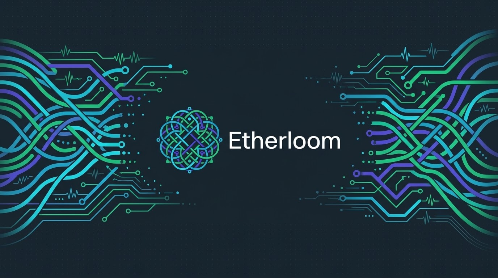
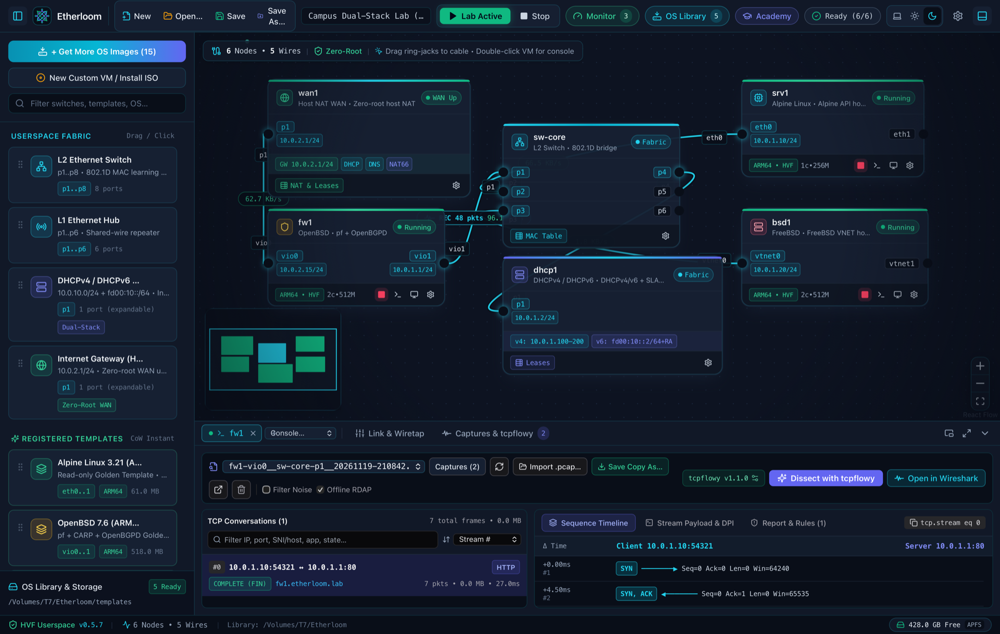
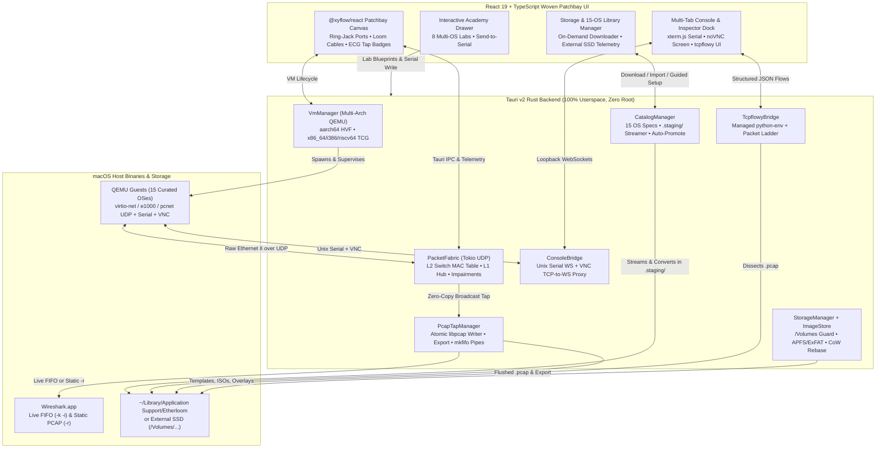

<div align="center">
  

  <p>
    <strong>Open-source, zero-root macOS network orchestration, packet-capture, and multi-OS learning studio</strong><br />
    built for Apple Silicon (<code>aarch64</code>) and Intel Macs.
  </p>

  <p>
    <a href="https://github.com/diorgulescu/etherloom/releases"></a>
    <a href="https://github.com/diorgulescu/etherloom/actions/workflows/ci.yml"></a>
    <a href="https://github.com/diorgulescu/etherloom/actions/workflows/release-macos.yml"></a>
    <a href="https://www.gnu.org/licenses/gpl-3.0"></a>
    <a href="#system-requirements"></a>
    <a href="#supported-15-os-catalog--multi-architecture-matrix"></a>
    <a href="#zero-root-architecture"></a>
  </p>
</div>

**Etherloom** lets students, network engineers, security researchers, and educators design multi-OS virtual networks across **15 curated operating systems** (**Linux**, **BSDs**, **Enterprise Routers & Firewalls**, **Plan 9 / Illumos**, and **Retro FreeDOS + mTCP**) alongside built-in **IEEE 802.1D L2 Switches**, **L1 Hubs**, **Dual-Stack DHCPv4/v6 + SLAAC Servers**, and **Zero-Root Host NAT Internet Gateways**, inject live link impairments, stream wiretaps directly into **Wireshark**, and visually dissect TCP flows inside the app using [**`tcpflowy`**](https://github.com/diorgulescu/tcpflowy) — all in **100% unprivileged userspace** with zero kernel extensions, zero `vmnet` helper daemons, and zero `sudo` prompts.

<div align="center">
  
  <p><em>Etherloom Studio in dark "Woven Patchbay" mode — orchestrating OpenBSD, FreeBSD, and Alpine Linux alongside zero-VM Host NAT &amp; Dual-Stack DHCPv4/v6 appliances with live in-app <code>tcpflowy</code> TCP packet dissection. <a href="https://diorgulescu.github.io/etherloom/">Explore more screenshots on the project site →</a></em></p>
</div>

---

## Key Highlights

- **Zero-Root Userspace Packet Fabric & In-Process Network Appliances**:
  - QEMU NICs connect via loopback UDP datagram sockets (`127.0.0.1`) to an async Rust `PacketFabric` that switches raw Ethernet II frames (including `802.1Q` VLAN tags & `9216`-byte jumbo frames), maintains live inspectable 802.1D MAC learning tables on L2 Switches, floods frames on L1 Hubs, and enforces per-wire **Latency (ms)**, **Jitter (±ms)**, **Packet Loss (%)**, and **Cable Cut** impairments in real time.
  - **Zero-Root Host NAT Internet Gateway (`nat_gateway`)**: Outbound `NAT44` & `NAT66` TCP/UDP/DNS (`:53` resolver proxy) & ICMP/ICMPv6 ping translation over unprivileged macOS sockets — with built-in WAN DHCP auto-configuration, live NAT session tables, and 100% wiretappable WAN Ethernet frames.
  - **Zero-VM Dual-Stack DHCPv4/v6 + SLAAC Server (`dhcp_server`)**: Instant `PacketFabric` appliance answering ARP, ICMPv4/v6 echo, DHCPv4 DORA (`UDP 67/68`), ICMPv6 Router Advertisements (`SLAAC A=1` + `RDNSS`), and stateful DHCPv6 `IA_NA` (`UDP 546/547`).
- **Multi-Architecture QEMU Engine (`aarch64`, `x86_64`, `i386`, `riscv64`)**:
  - **Native Hardware Virtualization (`-accel hvf`)** for ARM64 guests on Apple Silicon (`M1/M2/M3/M4`) and `x86_64` guests on Intel Macs.
  - **Multi-Threaded TCG (`-accel tcg,thread=multi`)** for cross-architecture router/firewall appliances (`OPNsense`, `pfSense CE`, `VyOS`, `OmniOS`, `DragonFly BSD`, `Haiku`) and instant sub-second retro stacks (`FreeDOS + mTCP` in `32 MB` RAM).
  - **Selectable NIC Hardware (`virtio-net-pci`, `e1000`, `rtl8139`, `pcnet`, `ne2k_pci`)** with automatic canvas port relabeling (`vtnet0` ↔ `em0`, `vio0` ↔ `em0`, `vioif0` ↔ `wm0`, `ether1`, `/net/ether0`, `e1000g0`, `PCNTPK 0x60`).
- **Unified Storage & 15-OS On-Demand Library Manager**: Download, SHA-256 verify, extract, convert, import, or delete OS images directly from the GUI onto your internal SSD or an external USB-C/Thunderbolt SSD (`/Volumes/...`), with HTTPS custom mirror overrides and **1-Click Guided Template Setup** that auto-promotes installed disks to read-only (`0444`) Copy-on-Write Golden Templates on shutdown.
- **Detachable Dual-Console Workspace & Real-Time Node Activity Monitor (`⌘⇧M`)**:
  - Every VM exposes a zero-buffered **Serial Terminal** (`@xterm/xterm`) and an **Embedded UEFI / VGA Screen** (`@novnc/novnc` over a Host/Origin-hardened loopback WebSocket bridge, or native macOS Cocoa window) inside a **pop-out, moveable, 8-way resizable floating dock**.
  - Built-in **Activity Monitor (`⌘⇧M`)** samples `proc_pid_rusage` physical memory (`ri_phys_footprint`), RSS, guest CPU %, CoW `.qcow2` disk I/O, rolling sparklines, and expandable per-NIC `PacketFabric` RX/TX rates.
- **One-Click Wiretaps, PCAP Export & Integrated `tcpflowy` Visual Flow Dissector**:
  - **Live Wireshark Stream**: Creates a `/tmp/etherloom/tap_<link>.pcap` named FIFO pipe (`mkfifo`) and launches `Wireshark.app` for live zero-root packet inspection alongside active `.pcap` recordings.
  - **Three Explicit 1-Click Capture Completion Actions**: Atomically flushes and `fsync`s `LINKTYPE_ETHERNET` `.pcap` captures (`<nodeA>-<nicA>__<nodeB>-<nicB>__<YYYYMMDD-HHMMSS>.pcap`) into `<project>.etherloom/captures/` with zero packet truncation, then lets you finish in one click via **Stop & Save PCAP...** (native macOS Save dialog + Finder reveal), **Stop & Open in Wireshark** (`Wireshark -r <pcap>`), or **Stop & Dissect with `tcpflowy`** (interactive **TCP Packet Ladder Diagrams**, **Reconstructed ASCII/Hex Streams**, **SPLT Timing & Entropy Profiles**, and **Auto-Synthesized Suricata / Wireshark / BPF Signatures**).
- **Interactive Networking Academy**: 8 built-in, multi-OS guided labs spanning Alpine Linux, OpenBSD, OpenWrt, MikroTik RouterOS CHR v7, and 32-bit FreeDOS (`mTCP`) — complete with declarative `lab.toml` blueprints, 1-click OS Library prerequisite handoffs, step-by-step Markdown drawers, wire highlights, and **Send to Serial** command blocks.
- **"Woven Patchbay" macOS Dark-Mode Studio UI**: Deep slate-navy topology canvas (`#0D1321`), translucent frosted-glass panels, patchbay VM/Switch cards with hollow **Ring-Jack** port handles and live traffic halos, multi-layer animated **"Loom" cables** with floating ECG waveform tap badges, a bespoke `xterm.js` ANSI dark palette, and color-coded `tcpflowy` sequence/handshake traces.

---

## Zero-Root Architecture



See [ARCHITECTURE.md](ARCHITECTURE.md) for the complete technical specification, QEMU UDP framing rules, `topology.toml` schema, and IPC contracts.

---

## Supported 15-OS Catalog & Multi-Architecture Matrix

Open **OS Library** in the top toolbar (or click **`+ Get More OS Images (15)`** in the left palette) to download, import, or launch 1-click guided setup for any of the 15 curated operating systems:

| # | Operating System | Category | Arch | Accel (Apple Silicon / Intel) | Default NIC & Guest Naming | Firmware / Disk | Default RAM | Networking & Lab Highlights |
| :-: | :--- | :--- | :---: | :---: | :--- | :---: | :---: | :--- |
| **1** | **Alpine Linux** | Linux | `aarch64` | **HVF** / TCG | `virtio-net-pci` (`eth0`, `eth1`) | UEFI / `virtio-blk` | `256 MB` | ~58 MB download, boots in ~2s; `iproute2`, `nftables`, `tcpdump` |
| **2** | **Debian Cloud** | Linux | `aarch64` | **HVF** / TCG | `virtio-net-pci` (`enp0s1` / `eth0`) | UEFI / `virtio-blk` | `512 MB` | Full `systemd` + `glibc` stack (`FRRouting`, `WireGuard`, Python/Go) |
| **3** | **FreeBSD** | BSD Family | `aarch64` | **HVF** / TCG | `virtio-net-pci` (`vtnet0` / `em0`) | UEFI / `virtio-blk` | `512 MB` | VNET network jails, `pf`/`ipfw`, `dummynet`, `CARP`, ZFS |
| **4** | **OpenBSD** | BSD Family | `aarch64` | **HVF** / TCG | `virtio-net-pci` (`vio0` / `em0`) | UEFI / `virtio-blk` | `512 MB` | SHA-256 verified `install76.img` + 1-click Guided Setup; `pf`, `CARP`, `pfsync`, `OpenBGPD` |
| **5** | **NetBSD** | BSD Family | `aarch64` | **HVF** / TCG | `virtio-net-pci` (`vioif0` / `wm0`) | UEFI / `virtio-blk` | `256 MB` | Pre-installed `evbarm-aarch64` image; `npf` firewall & rump kernels |
| **6** | **OpenWrt** | Routers & Firewalls | `aarch64` | **HVF** / TCG | `virtio-net-pci` (`eth0`, `eth1`) | UEFI / `virtio-blk` | `128 MB` | 14 MB image! Instant `ash` shell, UCI config, `fw4`/`nftables`, 802.1Q VLANs |
| **7** | **MikroTik RouterOS CHR** | Routers & Firewalls | `aarch64` | **HVF** / TCG | `virtio-net-pci` (`ether1`, `ether2`) | UEFI / `virtio-blk` | `256 MB` | Native ARM64 RouterOS v7 (`ether1..n` 1-based); BGP, OSPF, MPLS, VXLAN |
| **8** | **VyOS** | Routers & Firewalls | `x86_64` | MTTCG / **HVF** | `virtio-net-pci` (`eth0`, `eth1`) | SeaBIOS / `virtio-blk` | `1024 MB` | Juniper-style `configure`/`set`/`commit` CLI + FRRouting (`vyos`/`vyos`) |
| **9** | **OPNsense (`nano`)** | Routers & Firewalls | `x86_64` | MTTCG / **HVF** | `e1000` (`em0`, `em1`) | SeaBIOS / `virtio-blk` | `2048 MB` | Pre-installed `nano` serial appliance — boots straight to console & WebGUI |
| **10** | **pfSense CE** | Routers & Firewalls | `x86_64` | MTTCG / **HVF** | `e1000` (`em0`, `em1`) | UEFI / `virtio-blk` | `2048 MB` | Classic FreeBSD `pf` firewall (Local File Import from Netgate portal) |
| **11** | **9front (Plan 9)** | Research, UNIX & Retro | `aarch64` | **HVF** / TCG | `virtio-net-pci` (`/net/ether0`) | UEFI / `virtio-blk` | `512 MB` | Native ARM64 Plan 9 where the TCP/IP stack is a `/net` filesystem! |
| **12** | **OmniOS (Illumos)** | Research, UNIX & Retro | `x86_64` | MTTCG / **HVF** | `e1000` (`e1000g0`, `e1000g1`) | SeaBIOS / `virtio-blk` | `2048 MB` | Solaris/Illumos Crossbow (`dladm` VNICs/etherstubs, `ipadm`), DTrace, Zones |
| **13** | **DragonFly BSD** | BSD Family | `x86_64` | MTTCG / **HVF** | `e1000` (`em0`, `em1`) | SeaBIOS / `ahci` | `1024 MB` | Per-CPU lockless LWKT network protocol threads & HAMMER2 filesystem |
| **14** | **Haiku OS** | Research, UNIX & Retro | `x86_64` | MTTCG / **HVF** | `e1000` (`/dev/net/ipro1000/0`) | UEFI / `ahci` | `1024 MB` | Ultra-responsive BeOS-inspired graphical desktop over Embedded VNC |
| **15** | **FreeDOS + mTCP** | Research, UNIX & Retro | `i386` | Fast TCG | `pcnet` (`PCNTPK 0x60`) | SeaBIOS / `ide` | `32 MB` | Boots in <1s! Crynwr packet drivers + mTCP with **zero** background OS noise |

---

## External SSD & On-Demand Storage Management

Modern laptops often have tight internal SSD space, so Etherloom is engineered from the ground up for external USB-C / Thunderbolt SSDs (`/Volumes/<DriveName>/Etherloom`):

1. **Zero `/tmp` Bloat (`.staging/` Streaming)**: When you download or extract multi-hundred-MB images in the **Storage & OS Library Manager**, `curl` streams, checksum verification, `.xz`/`.gz`/`.bz2`/`.zip` decompression, and `qemu-img convert` all run strictly inside `{active_storage_root}/.staging/` before atomically moving into `templates/` or `isos/`.
2. **Smart Internal vs. External Split**:
   - **Always Local**: `~/Library/Application Support/Etherloom/settings.toml`, `python-env/` (which requires POSIX symlinks incompatible with ExFAT), and `/tmp/etherloom/` sockets/FIFOs (avoiding macOS's `104-byte sun_path` Unix socket limit and ExFAT FIFO restrictions).
   - **Relocatable Heavy Media**: `templates/`, `isos/`, and `projects/*.etherloom` live wherever you choose — internal APFS or external APFS/ExFAT SSDs, with live `statfs` free/total capacity telemetry.
3. **Unplugged Drive Protection & Portable CoW Rebase**:
   - Etherloom checks POSIX `st_dev` device IDs before touching `/Volumes/<Name>`, never creating phantom folders under `/Volumes` if a drive is unplugged.
   - Moving templates or opening a `*.etherloom` workspace on another Mac automatically updates Copy-on-Write backing pointers via `qemu-img rebase -u`.
4. **Safe Deletion Guard**: Deleting an OS image from the Library Manager scans your saved `*.etherloom` project overlays first and warns you if any existing lab depends on that Golden Template.

---

## Companion CLI Scripts (`scripts/`)

Prefer terminal workflows or pre-provisioning a classroom drive? Etherloom ships two standalone GPLv3 scripts in [`scripts/`](scripts/) that share the exact same `<slug>-<arch>-base.qcow2` naming convention as the GUI Library Manager:

### 1. `scripts/prepare_library.sh` (also `scripts/prepare-library.sh`)
Downloads, verifies, expands, and write-protects (`chmod 0444`) official `aarch64` base images onto local or external storage:

```bash
# Install QEMU + xz (for decompressing FreeBSD / Alpine cloud images)
brew install qemu xz

# Provision Alpine, FreeBSD, NetBSD & SHA-256-verified OpenBSD installer onto an external SSD
./scripts/prepare-library.sh /Volumes/Samsung_T7/Etherloom

# Or provision selected OS families onto default internal storage
./scripts/prepare-library.sh ~/Library/Application\ Support/Etherloom/Library --only alpine,freebsd

# Launch the interactive 2-minute HVF terminal setup to build openbsd-aarch64-base.qcow2
./scripts/prepare-library.sh /Volumes/Samsung_T7/Etherloom --setup-openbsd
```

### 2. `scripts/smoke-test-wire.sh`
Spins up two Copy-on-Write QEMU HVF guests wired back-to-back over raw UDP Ethernet sockets in `tmux` / `Terminal.app`, attaches a `.pcap` wiretap, and optionally streams live frames into Wireshark:

```bash
./scripts/smoke-test-wire.sh /Volumes/Samsung_T7/Etherloom --node1 alpine --node2 freebsd
```

---

## Wire Capture, PCAP Export & `tcpflowy` Visual Flow Dissector

Click or right-click any virtual cable on the canvas (or open the **Link & Wiretap** / **Captures & tcpflowy** tabs in the Bottom Dock) to inspect every frame without `bpf` group changes or `sudo`. Active recordings display a live `REC MM:SS` timer, packet counter, and byte size alongside coexisting **Live Wireshark** streaming:

| Capture Workflow | Action | Behavior |
| :--- | :--- | :--- |
| **Live Stream** | **Live Wireshark (`mkfifo`)** | Streams real-time `LINKTYPE_ETHERNET` frames into `/Applications/Wireshark.app` over `/tmp/etherloom/tap_<link_id>.pcap` (runs independently alongside `.pcap` file recording). |
| **Stop & Export** | **Stop & Save PCAP...** | Atomically drains, flushes, and `fsync`s the canonical `<nodeA>-<nicA>__<nodeB>-<nicB>__<YYYYMMDD-HHMMSS>.pcap` in `<project>.etherloom/captures/` first, then opens a native macOS Save dialog and surfaces a 1-click **Reveal in Finder** toast. |
| **Stop & Inspect** | **Stop & Open in Wireshark** | Finalizes the `.pcap` with zero packet truncation and launches `Wireshark.app` in static file read mode (`-r <pcap_path>`). |
| **Stop & Dissect** | **Stop & Dissect (`tcpflowy`)** | Finalizes the `.pcap` and immediately dissects TCP flows in-app via [**`tcpflowy`**](https://github.com/diorgulescu/tcpflowy) inside Etherloom's managed `python-env/`. |
| **Captures History** | **Dissect / Wireshark / Save Copy As... / Finder** | Every saved capture in `captures/*.pcap` can be re-dissected in `tcpflowy`, opened in `Wireshark.app`, exported anywhere on macOS, or revealed in macOS Finder (`open -R`). |

Inside the integrated **`tcpflowy` Visual Flow Dissector**, you can inspect:
- **Interactive Packet Ladder**: Step through `SYN` → `SYN,ACK` → `ACK`, `PSH,ACK` payload turns, `FIN`/`RST` teardowns, duplicate ACKs, retransmissions, and zero-window events.
- **Stream Reconstruction & SPLT Signatures**: View reassembled `C->S` and `S->C` ASCII/Hex payloads, SPLT packet-length/inter-arrival signatures, Shannon entropy classification, passive DNS maps, and ready-to-copy **Wireshark**, **BPF**, & **Suricata** rules.

---

## Interactive Networking Academy

Click **Academy** in the top toolbar to instantiate a clean sandbox copy (`academy-<lab_id>.etherloom`) paired with the collapsible right-side **Lab Guide Drawer**. If a lab requires an OS image that has not been downloaded yet, Etherloom surfaces a 1-click **Download / Setup in OS Library** deep-link filtered directly to the missing catalog items:

| # | Lab Title | Difficulty | Guest Operating Systems | Core Networking Concepts Covered |
| :-: | :--- | :---: | :--- | :--- |
| **01** | **Ethernet, Hubs vs. Switches & ARP Under the Microscope** | `Beginner` | Alpine Linux (`aarch64` HVF) + Virtual L1 Hub & L2 Switch | Shared-medium L1 Hub flooding vs. L2 Switch `802.1D` MAC learning, broadcast ARP requests vs. unicast ARP replies |
| **02** | **IP Subnetting & Static Routing From Scratch** | `Beginner` | Alpine Linux (`aarch64` HVF) | Dual `/24` subnets, multi-homed Linux IPv4 forwarding, static routes (`ip route`), L2 MAC rewrites & IP `TTL` decrement |
| **03** | **Stateful Firewalls & NAT with OpenBSD `pf`** | `Intermediate` | OpenBSD + Alpine Linux (`aarch64` HVF) | OpenBSD `vio0`/`vio1`, default-deny `/etc/pf.conf`, `nat-to` masquerading, `rdr-to` port forwarding, `pfctl -ss`, dual-wire `tcpflowy` NAT proof |
| **04** | **High-Availability Failover with OpenBSD `CARP` + `pfsync`** | `Advanced` | OpenBSD + Alpine Linux (`aarch64` HVF) | Active/Backup OpenBSD firewall cluster, shared `carp0` virtual IP (`vhid 1`), live TCP state replication over `pfsync0`, zero-drop cable-cut failover |
| **05** | **Dissecting TCP: Handshakes, Window Scaling & Packet Loss** | `Intermediate` | Alpine Linux (`aarch64` HVF) | Impaired WAN link (`80 ms` RTT, `5%` loss), 3-way handshake, window scaling, duplicate ACKs & RTO/fast-retransmit ladders in `tcpflowy` |
| **06** | **Zero-Noise ARP & TCP Dissection with FreeDOS (`mTCP`)** | `Beginner` | FreeDOS 1.3 (`i386` TCG, `32 MB` RAM, `pcnet`) + Alpine Linux (`aarch64` HVF) | Silencing Linux IPv6 link-up chatter, Crynwr `PCNTPK INT 0x60` packet driver + `mTCP`, exact 4-packet ARP+ICMP exchange, pure `SEQ`/`ACK` byte math in `tcpflowy` |
| **07** | **802.1Q VLAN Segmentation, Trunking & Inter-VLAN Routing on OpenWrt** | `Intermediate` | OpenWrt (`aarch64` HVF) + Alpine Linux (`aarch64` HVF) | Modern UCI `bridge-vlan` / DSA filtering (`eth0:u*`, `eth1:u*`, `eth2:t`), L2 broadcast isolation, double-tagged `0x8100` trunk captures, Router-on-a-Stick & `fw4`/`nftables` zone isolation |
| **08** | **Multi-Vendor eBGP Peering & Route Failover: MikroTik CHR v7 ↔ OpenBSD (`OpenBGPD`)** | `Advanced` | MikroTik RouterOS CHR v7 + OpenBSD + Alpine Linux (`aarch64` HVF) | Authentic RouterOS v7 `/routing/bgp/connection` + `/routing/filter/rule`, OpenBSD `/etc/bgpd.conf`, **RFC 8212** explicit import/export policy, `TCP/179` `OPEN`/`UPDATE`/`KEEPALIVE` dissection & live cable-cut BGP reconvergence |

Instructors can author custom labs by placing `<lab-id>/lab.toml` + `guide.md` inside [`labs/`](labs/) or `{storage_root}/labs/` — complete with `highlight_links` canvas illumination and `node=<id>` **Send to Serial** command blocks.

---

## System Requirements

| Component | Minimum | Recommended | Notes |
| :--- | :--- | :--- | :--- |
| **Operating System** | **macOS 13** (Ventura) | **macOS 14+** (Sonoma / Sequoia / Tahoe / macOS 27+) | Uses Apple `Hypervisor.framework` (`-accel hvf`) in unprivileged userspace |
| **Processor (CPU)** | Apple Silicon (`M1`+) or Intel `x86_64` (`VT-x`) | Apple `M1 Pro` / `M2` / `M3` / `M4` (8+ cores) | Native `HVF` when guest arch matches host (`aarch64` on M-series, `x86_64` on Intel); multi-threaded `TCG` (`thread=multi`) for cross-arch guests |
| **Memory (RAM)** | **8 GB** | **16 GB+** | Lightweight labs use `32 MB` (FreeDOS), `128 MB` (OpenWrt), `256 MB` (Alpine / MikroTik CHR), and `512 MB` (OpenBSD / FreeBSD); `16 GB+` recommended for multi-router topologies or `x86_64` firewalls (`OPNsense` / `VyOS`) |
| **Internal Disk Space** | **500 MB** free | **2 GB+** free | Stores `~/Library/Application Support/Etherloom/settings.toml`, the local `tcpflowy` `python-env/` venv, and ephemeral `/tmp/etherloom/` Unix sockets & FIFO pipes |
| **OS Library Storage** | **4 GB** free | **20–40 GB+** free (Internal SSD or External USB-C / Thunderbolt SSD) | Configurable in **OS Library → Paths & Migrate**; supports **APFS** (sparse `qcow2` overlays) and **ExFAT** external drives (`/Volumes/...`) with `.staging/` extraction |
| **Account Privileges** | **Standard macOS User** | **Standard macOS User** | **Zero `root` / `sudo`**, zero `.kext` / system extensions, zero `bpf` group changes |
| **Host Packages** | **QEMU 8.2+** (`brew install qemu`) | **QEMU 9.x+** + **Wireshark 4.x+** + **Python 3.10+ / `uv`** | Verified live via the in-app **Env Doctor** toolbar badge (`qemu-system-*`, `qemu-img`, `edk2` UEFI firmware, `Wireshark.app`/`tshark`, `python3`/`uv`) |
| **Source Build Tools** *(optional)* | Xcode CLT, **Rust 1.77.2+**, **Node.js 20+** | Latest stable `rustup` + Node `20`/`22` LTS | Only needed when building Etherloom from source (`npm run tauri dev` / `build`) |

---

## Prerequisites & Installation (macOS)

Etherloom runs on **macOS 13+** (including **macOS 15–27+**) on both **Apple Silicon** (`M1` / `M2` / `M3` / `M4`) and **Intel** Macs.

### 1. Pre-Built macOS Release (`.dmg` / `.app`) & Gatekeeper Note

Download the latest Apple Silicon (`arm64`) or Intel (`x64`) `.dmg` from [**GitHub Releases**](https://github.com/diorgulescu/etherloom/releases) and drag **`Etherloom.app`** into **`/Applications`**.

> **macOS Gatekeeper Note (Safari / Chrome Downloads on macOS 15–27+)**: Open-source release builds are ad-hoc code-signed (`Signature=adhoc`) without a paid Apple Developer ID notarization ticket. When downloaded in a browser, macOS attaches `com.apple.quarantine` and may display *"“Etherloom” is damaged and can't be opened"*. Run once in Terminal to clear quarantine:
> ```bash
> xattr -dr com.apple.quarantine /Applications/Etherloom.app
> ```
> *(Or run `./scripts/allow-macos-app.sh /Applications/Etherloom.app` from the repository or `.app.tar.gz` archive.)*

### 2. Host Runtime Packages (Homebrew)

```bash
# Required: Multi-architecture QEMU (aarch64, x86_64, i386, riscv64) + EDK2 UEFI firmware + qemu-img
brew install qemu

# Optional (recommended): Live FIFO wiretap streaming & 1-click static .pcap inspection in Wireshark.app
brew install --cask wireshark

# Optional (recommended): Python 3.10+ & uv for the in-app tcpflowy Flow Dissector
brew install python uv
```

> **Tip**: Click the **Env Doctor** badge in Etherloom's top toolbar anytime to verify all 6 host dependencies (`qemu-system-aarch64`, multi-arch `qemu-system-x86_64`/`i386`/`riscv64`, `qemu-img`, `edk2` UEFI firmware, `Wireshark`, and `python3`/`uv`).

### 3. Build & Run From Source

Ensure **Rust** (`1.77+` via [`rustup`](https://rustup.rs/)), **Node.js** (`20+` LTS), and **Xcode Command Line Tools** (`xcode-select --install`) are installed:

```bash
git clone https://github.com/diorgulescu/etherloom.git
cd etherloom

# Install frontend dependencies
npm install

# Launch Etherloom in development mode
npm run tauri dev

# Build standalone macOS .app / .dmg release bundle
npm run tauri build
```

### 4. Automated Verification & Test Suite

```bash
# Validate shell scripts
bash -n scripts/prepare_library.sh scripts/prepare-library.sh scripts/smoke-test-wire.sh scripts/bump-version.sh scripts/allow-macos-app.sh

# Type-check React 19 + TypeScript and build production Vite bundle
npm run build

# Check & run Rust backend unit tests (env_doctor, multi-arch vm_manager, images, catalog, storage, fabric, workspace, pcap, tcpflowy, academy)
cargo check --manifest-path src-tauri/Cargo.toml --all-targets
cargo test --manifest-path src-tauri/Cargo.toml
```

### 5. Versioning & Automatic Revision Bumping

Etherloom tracks a single semantic version (`MAJOR.MINOR.PATCH`) in [`VERSION`](VERSION), synchronized across `package.json`, `package-lock.json`, `src-tauri/tauri.conf.json`, `src-tauri/Cargo.toml`, and `src-tauri/Cargo.lock` via [`scripts/bump-version.sh`](scripts/bump-version.sh):

- **Automatic Patch Bumps**: `.githooks/pre-commit` (installed automatically by `npm install` via `git config core.hooksPath .githooks`) and `.github/workflows/auto-version-bump.yml` automatically increment the revision number (`0.5.0` → `0.5.1` → `0.5.2`) on every commit/push unless an explicit version change is already staged.
- **Explicit Minor / Major Bumps**:
  ```bash
  npm run version:minor          # e.g. 0.5.x -> 0.6.0
  npm run version:major          # e.g. 0.x.y -> 1.0.0
  ./scripts/bump-version.sh set 0.5.0
  ```

---

## Contributors

- **[Dragoş Iorgulescu (`@diorgulescu`)](https://github.com/diorgulescu)** — Creator, System Architecture, [`tcpflowy`](https://github.com/diorgulescu/tcpflowy) Author & Project Maintainer
- **[Antigravity](https://antigravity.google/)** *(Google DeepMind Agentic AI)* — Co-Author & Engineering Contributor (Multi-Architecture Tauri/Rust Backend, Zero-Root `PacketFabric`, React Topology Studio, 15-OS Catalog & Guided Academy Labs)
- **[Mistral Vibe](https://mistral.ai/products/vibe/code/)** *(Mistral AI)* — Engineering Contributor (Userspace DHCP/NAT Appliances, Floating Console Workspace & Security Hardening)

---

## Credits & License (GNU GPLv3)

Etherloom is free and open-source software distributed under the **GNU General Public License v3.0 (or later)** (`SPDX-License-Identifier: GPL-3.0-or-later`).

- See [**LICENSE**](LICENSE) for license terms.
- See [**CREDITS.md**](CREDITS.md) for upstream attributions, including [**`tcpflowy`**](https://github.com/diorgulescu/tcpflowy), [**QEMU**](https://www.qemu.org/), [**TianoCore EDK II**](https://github.com/tianocore/edk2), [**Wireshark**](https://www.wireshark.org/), [**Tauri v2**](https://tauri.app/), [**React**](https://react.dev/), [**`@xyflow/react`**](https://reactflow.dev/), [**`xterm.js`**](https://xtermjs.org/), [**`noVNC`**](https://novnc.com/), and the communities behind all 15 supported guest operating systems.
